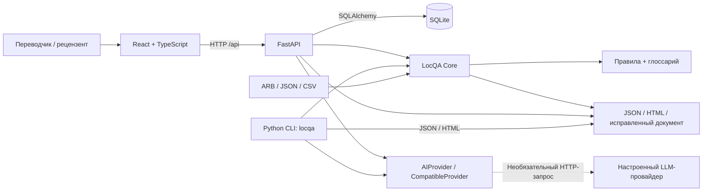

# QazaqLoc Studio

**Intelligent Game Localization Quality Assurance Platform**

Контроль качества казахской локализации игр: программные правила, терминология, предложения ИИ и проверка человеком.

**Қазақша:** QazaqLoc Studio — ойындардың қазақша локализациясындағы техникалық және терминологиялық қателерді табуға арналған жергілікті веб-қосымша және CLI. Аударманы өңдеуге, адам тексеруін тіркеуге және нәтижелерді экспорттауға мүмкіндік береді. Интерфейс қазақ және орыс тілдерін қолдайды.

**Версия:** `1.0.0` · **Состояние:** локальный MVP · **Основной язык интерфейса:** қазақша

> Приложение работает без API-ключа в режиме программных правил. Демонстрационные исправления не прошли проверку носителем языка. Роль Reviewer и наличие ИИ сами по себе не подтверждают качество перевода.

## Содержание

- [Обзор проекта](#overview)
- [Проблема и решение](#problem-solution)
- [Возможности и состояние реализации](#features)
- [Интерфейс](#screenshots)
- [Архитектура](#architecture)
- [Технологический стек](#stack)
- [Системные требования](#requirements)
- [Установка на Windows](#installation)
- [Запуск приложения](#running)
- [Руководство пользователя](#workflow)
- [CLI-инструмент locqa](#cli)
- [Обнаруживаемые ошибки](#checks)
- [ИИ-анализ](#ai)
- [Человеческая проверка](#human-review)
- [Форматы входных файлов](#input-formats)
- [Отчёты и конкурсные файлы](#exports)
- [Оценка качества](#evaluation)
- [Тестирование](#testing)
- [API](#api)
- [Ограничения](#limitations)
- [Устранение неполадок](#troubleshooting)
- [Документация и структура проекта](#documentation)
- [Команда проекта](#team)
- [Дальнейшее развитие](#roadmap)

<a id="overview"></a>

## Обзор проекта

QazaqLoc Studio помогает разработчикам игр, переводчикам и рецензентам проверять локализацию с английского или русского на казахский язык. Приложение сопоставляет оригинал и перевод, находит технические дефекты, проверяет терминологические правила и сохраняет решения людей по конкретным версиям текста.

В проект входят веб-интерфейс, сервер с локальной базой и независимый Python CLI `locqa`. Веб и CLI используют **один LocQA Core**: правила анализа не дублируются во frontend.

Это инструмент QA, а не система массового машинного перевода. Он не переводит автоматически каждую строку и не применяет предложения без действия пользователя. Для части проблем движок предлагает исправление; в остальных случаях переводчик вводит вариант вручную. Финальная языковая оценка остаётся задачей квалифицированного рецензента.

<a id="problem-solution"></a>

## Проблема и решение

### Проблема

Одна игровая сущность может получать разные названия в меню, заданиях и инвентаре. Грамматически правдоподобный перевод способен передавать неверное действие: `Save game` и `Save the princess` требуют разного понимания слова `Save`. Без контекста кнопки, предмета или реплики словарная замена ненадёжна.

Технические ошибки нарушают работу интерфейса независимо от литературного качества: потерянный `{playerName}`, повреждённый ICU plural, незакрытый HTML-тег или пустое значение. Длинный перевод может потребовать изменения вёрстки, но количество символов само по себе не доказывает переполнение.

### Гибридное решение

| Уровень | Задача | Граница ответственности |
|---|---|---|
| Программные правила | Ключи, переменные, поддерживаемые конструкции ICU, теги, Unicode, форматирование | Не оценивают всю грамматику и смысл |
| Глоссарий | Термины оригинала, контекст, запрещённые варианты | Не выполняет полноценный морфологический анализ |
| Необязательный ИИ | Предложения по грамматике, орфографии, стилю и контексту | Зависит от провайдера; требует проверки |
| Человек | Редактирование, отклонение, одобрение конкретной версии | Роль в системе не свидетельствует о владении языком |

<a id="features"></a>

## Возможности и состояние реализации

### Реализовано в текущем MVP

- **Проекты:** создание с жанром, исходным языком и контекстом; загрузка файлов; история анализов; удаление с подтверждением.
- **Анализ:** ARB/JSON/CSV, технические и терминологические правила, объяснения, критичность, источник и эвристическая уверенность.
- **Главная панель:** показатели из сохранённых данных, распределение проблем по категориям и критичности, прогресс человеческой проверки.
- **Редактор:** три колонки, ручная правка, применение предложения в поле редактора, сохранение и отправка на проверку.
- **Навигация:** поиск, фильтры по категории/критичности/статусу/источнику, сортировка, список по 50 элементов, горячие клавиши.
- **Рецензирование:** Administrator / Translator / Reviewer, комментарии, версии текста, журнал действий, сохранение одобрений в SQLite.
- **Глоссарий:** создание, изменение, удаление, поиск и фильтрация, CSV-импорт/экспорт, проверка повторов по термину и контексту, подключение выбранных терминов к проекту.
- **Экспорт:** JSON, автономный HTML, исправленный файл исходного формата, глоссарий, отдельный audit JSON и ZIP-пакет.
- **Предпросмотр:** кнопка, диалог, уведомление, меню, карточка предмета; выбор текста/языка, изменение ширины и измерение переполнения в браузере.
- **Evaluation:** собственный эталонный JSON-набор, precision/recall/F1 и метрики исправлений после запуска.
- **Интерфейс:** KK/RU, тёмная/светлая темы, адаптивная раскладка, локальные файлы Noto Sans с расширенной кириллицей.
- **CLI:** независимый анализ, JSON/HTML, JSON-конфигурация контекста и коды завершения для автоматизации.

### Частично реализовано или требует внешней проверки

| Область | Текущее состояние |
|---|---|
| Лингвистический анализ | Есть ИИ-адаптер с валидацией и резервным режимом правил; живой запрос с реальным ключом в приведённой проверке не выполнялся |
| ICU MessageFormat | Поддерживается подмножество; полная совместимость с Flutter/ICU runtime не заявлена |
| Контекст терминов | Текстовое сопоставление описания проекта, ключа и метаданных, а не полноценный семантический анализ |
| Проверка носителем | Механизм реализован, но демонстрационные исправления и интерфейс ещё требуют независимой языковой вычитки |
| Game UI Preview | Измеряет шаблонный компонент, не воспроизводит все экраны конкретной игры |

### Запланированные направления

Фоновые задания, несколько организаций, независимый промышленный benchmark, морфологический анализ, интеграции с игровыми движками и расширение CLI пока **не реализованы**. Подробнее — в [плане развития](#roadmap); сроков реализации не заявлено.

<a id="screenshots"></a>

## Интерфейс

Снимки получены браузерными тестами работающего приложения, а не из дизайн-макетов. Отдельного файла логотипа нет: знак и название в интерфейсе оформлены HTML/CSS.

**Главная панель, казахский интерфейс.** Нулевые показатели соответствуют новому рабочему пространству.


<details>
<summary>Рецензирование</summary>


Одобрение на снимке создано тестовым аккаунтом для проверки механизма. Оно не подтверждает рецензирование носителем языка.

Мобильный интерфейс поддерживается; локальные снимки создаются браузерными тестами.

</details>

<a id="architecture"></a>

## Архитектура



LocQA Core — Python-модули в [locqa/](locqa/). Сервер и CLI вызывают общие парсеры, правила и экспортёры. Сервер сохраняет проекты, исходные тексты, результаты запусков и рецензии. CLI для анализа не использует аккаунты или серверную БД.

В обычном режиме FastAPI обслуживает API и frontend-сборку. В разработке интерфейс обслуживает Vite, проксируя `/api` на backend. Детали хранения и моделей: [ARCHITECTURE.md](docs/ARCHITECTURE.md).

<a id="stack"></a>

## Технологический стек

| Слой | Технологии | Назначение |
|---|---|---|
| Интерфейс | React 18, TypeScript, Vite 6 | Компоненты, типизация, dev-сервер и сборка |
| Оформление | Tailwind CSS 3, собственный CSS, Radix Dialog | Стили, адаптивность, диалоги; локальные компоненты в стиле shadcn/ui, без отдельного установленного пакета shadcn |
| Визуальные элементы | Lucide React, Framer Motion, Recharts | Иконки, переходы, диаграммы |
| Данные и навигация | TanStack Query, React Router, i18next, react-i18next | API-кэш, маршруты и KK/RU |
| Шрифт | `@fontsource-variable/noto-sans` | Локально поставляемые файлы Noto Sans |
| API | FastAPI, Pydantic, Uvicorn | HTTP-маршруты, схемы и сервер |
| Хранилище | SQLAlchemy 2, SQLite | Пользователи, сессии, проекты, глоссарий |
| CLI | Python, Typer | Команды `check` и `evaluation` |
| ИИ-адаптер | HTTPX, Pydantic | HTTP-запросы и проверка ответа |
| Тесты | pytest, HTTPX TestClient, Playwright | Ядро/CLI/API и браузерные сценарии |

Диапазоны Python-зависимостей: [pyproject.toml](pyproject.toml). Frontend-зависимости: [package.json](frontend/package.json); разрешённые npm-версии: [package-lock.json](frontend/package-lock.json).

<a id="requirements"></a>

## Системные требования

| Компонент | Требование |
|---|---|
| ОС | Windows 10/11 — целевая среда скриптов |
| Python | 3.11+, доступен командой `python` |
| Node.js | 20+; рекомендуется 20.19+ или более новая LTS-версия. Установщик проверяет major-версию |
| npm | Поставляется с Node.js; нужен для установки, сборки и frontend-тестов |
| Терминал | PowerShell; команды ниже выполняются из корня проекта, если не указано иное |
| Браузер | Современный браузер; для тестов отдельно устанавливается Playwright Chromium |
| Сеть | Для первоначальной загрузки зависимостей и необязательных запросов к внешнему ИИ |

Docker, отдельный сервер СУБД, платный хостинг и API-ключ для локального анализа по правилам не нужны. После установки зависимости и шрифты обслуживаются локально. Другие ОС в этой инструкции не проверены.

<a id="installation"></a>

## Установка на Windows

### 1. Подготовить окружение

Установите Python и Node.js с npm, включив добавление в `PATH`. Откройте папку проекта в VS Code и выберите **Терминал → Создать терминал**. Проверьте:

```powershell
python --version
node --version
npm --version
Get-Location
Test-Path .\pyproject.toml
```

Последняя команда должна вывести `True`: терминал открыт в корне проекта. Если программы только установлены и не находятся, перезапустите VS Code.

### 2. Установить зависимости

```powershell
powershell -ExecutionPolicy Bypass -File .\setup-windows.ps1
```

`ExecutionPolicy` задаётся для запускаемого процесса PowerShell. Скрипт создаёт или использует `.venv`, устанавливает Python-пакет с тестовыми зависимостями, выполняет `pip check`, `npm ci`, `npm ls`, собирает frontend и подготавливает SQLite с учётом `.env`. При ошибке этапа он останавливается. Активация `.venv` не требуется. Опция `-WithBrowser` дополнительно устанавливает Playwright Chromium.

<details>
<summary>Ручная установка тех же компонентов</summary>

```powershell
python -m venv .venv
.\.venv\Scripts\python.exe -m pip install -e ".[test]"

Push-Location .\frontend
npm ci
npm run build
Pop-Location

.\.venv\Scripts\python.exe -c "from backend.db import database; database()"
```

Остановитесь и исправьте ошибку, если шаг завершился неуспешно. `npm ci` требует lock-файла и переустанавливает frontend-зависимости.

</details>

### 3. При необходимости создать конфигурацию

Для анализа без ИИ шаг можно пропустить. Команда сохраняет уже существующий `.env`:

```powershell
if (-not (Test-Path .\.env)) {
    Copy-Item .\.env.example .\.env
}
```

Поля описаны в [разделе об ИИ](#ai). `.env` исключён из Git; не публикуйте его содержимое.

<a id="running"></a>

## Запуск приложения

### Обычный локальный режим

```powershell
.\start-local.cmd
```

| Адрес по умолчанию | Назначение |
|---|---|
| http://127.0.0.1:8000 | Веб-приложение из `frontend/dist` |
| http://127.0.0.1:8000/api/health | Состояние API и наличие настройки ИИ |
| http://127.0.0.1:8000/docs | Интерактивная документация OpenAPI |

Скрипт запускает **один Uvicorn-процесс**, обслуживающий frontend и backend. Если отсутствуют Python-окружение, нужные модули или frontend-сборка, он вызывает автоматическую установку. Отдельно запускать Vite и SQLite не нужно. Остановка — `Ctrl+C`; при вопросе Windows о завершении пакетного задания подтвердите. Режим `.\start-local.cmd --check` проверяет файлы, зависимости, конфигурацию и таблицы без запуска сервера.

По умолчанию база создаётся в `data/qazaqloc.db` относительно корня проекта, независимо от рабочей папки процесса. Каталог и таблицы создаются при инициализации backend; проекты и одобрения сохраняются между перезапусками. Перед резервным копированием файла БД остановите сервер.

При `PORT=8001` в `.env` приложение доступно на http://127.0.0.1:8001. Локальный запуск печатает фактически настроенный адрес. Некорректный или занятый порт сопровождается сообщением с инструкцией.

### Разработка: два терминала

**Терминал 1, корень проекта — backend:**

```powershell
.\.venv\Scripts\python.exe -m uvicorn backend.app:app --host 127.0.0.1 --port 8000 --reload
```

**Терминал 2, корень проекта — frontend:**

```powershell
Set-Location .\frontend
npm run dev
```

Откройте адрес Vite; при свободном порте это http://127.0.0.1:5173. Proxy в `frontend/vite.config.ts` направляет `/api` на `http://127.0.0.1:8000`. При изменении backend-порта в этом режиме измените и proxy.

**Важно:** скрипты локального запуска, диагностики и подготовки БД автоматически читают `.env` через `scripts/local_config.py`. Прямые Uvicorn и CLI получают настройки из переменных окружения процесса. Уже заданные переменные имеют приоритет над `.env`.

<a id="workflow"></a>

## Руководство пользователя

1. **Зарегистрируйтесь.** Первый аккаунт новой БД становится Administrator, последующие — Translator. Пароль — не менее 10 символов; готовых логинов и паролей нет. При необходимости переключите KK на RU.
2. **Создайте проект.** Укажите название, жанр, язык оригинала EN/RU и контекст. Целевой язык — KK. Либо откройте демо Steppe Legends: создание демо ещё не запускает анализ.
3. **Загрузите файлы.** В «Анализ ошибок» выберите оригинал и казахский перевод, затем нажмите «Загрузить файлы». У демопроекта файлы уже приложены.
4. **Настройте терминологию.** При необходимости импортируйте CSV в «Глоссарий». В анализаторе «Подключить к проекту» сохраняет выбранные термины; без этого используется общий набор. Импорт заменяет общий глоссарий. Прикреплённый набор — отдельная сохранённая копия.
5. **Запустите анализ.** По умолчанию работают правила; при настройке сервера можно добавить ИИ. Откройте проблему в редакторе.
6. **Подготовьте исправление.** Сравните три колонки. «Применить предложение» переносит текст в поле редактора; после этого нажмите «Сохранить». Сохранение не означает одобрение. Сервер проверяет переменные, ICU, теги и недопустимые символы.
7. **Передайте на рецензию.** Нажмите «На проверку»: в текущей модели это `needs_revision`, отдельного статуса очереди нет. Администратор назначает настоящему участнику роль Reviewer в «Настройки».
8. **Выполните проверку человеком.** Reviewer или Administrator может одобрить, отклонить или вернуть текст на доработку с комментарием. «Все строки» включает и строки без найденных проблем.
9. **Проверьте шаблон интерфейса.** В «Игровой интерфейс» выберите компонент, ключ, язык и ширину. Предупреждение относится к выбранному шаблону.
10. **Повторите анализ и экспортируйте.** Новый анализ использует сохранённые исправления. В анализаторе выберите JSON, HTML, исправленный файл, журнал или ZIP. Сохраняйте audit вместе с переводом.

Горячие клавиши: `Ctrl+Enter` — сохранение, в режиме рецензии — одобрение при наличии прав; `Alt+→` — следующая строка. Выбор другой строки не сохраняет введённый текст автоматически.

Повторная загрузка файлов сбрасывает активные исправления и текущий отчёт; события загрузки и прежние анализы остаются в истории. Исходные файлы на диске пользователя не переписываются. Подробное руководство на казахском: [USER_GUIDE.md](docs/USER_GUIDE.md).

<a id="cli"></a>

## CLI-инструмент locqa

После установки пакета команда находится в `.venv\Scripts\locqa.exe`. Для анализа не нужны веб-интерфейс, аккаунт или сервер.

### Анализ файлов

Одна строка PowerShell из корня проекта:

```powershell
.\.venv\Scripts\locqa.exe check samples/intl_kk.arb --source samples/intl_en.arb --glossary samples/glossary.csv --report artifacts/cli-report.json --html artifacts/cli-report.html --no-ai
```

Эквивалентный запуск через модуль:

```powershell
.\.venv\Scripts\python.exe -m locqa.cli check samples/intl_kk.arb --source samples/intl_en.arb --glossary samples/glossary.csv --report artifacts/cli-report.json --html artifacts/cli-report.html
```

На текущих демофайлах результат — **16 проверенных строк, 8 проблем**. Команда создаёт два отчёта, не меняя входной ARB.

| Аргумент / параметр `check` | Назначение | По умолчанию |
|---|---|---|
| `TARGET` | Проверяемая локализация | Обязателен |
| `--source PATH` | Оригинал | Обязателен |
| `--glossary PATH` | CSV-глоссарий | Без глоссария |
| `--report PATH` | JSON-отчёт | `report.json` |
| `--html PATH` | HTML-отчёт | `report.html` |
| `--ai` / `--no-ai` | Запрашивать / не запрашивать ИИ | `--no-ai` |
| `--config PATH` | JSON; сейчас используется поле `context` | Без файла |
| `--fail-on-issues` | Код 1 при любых замечаниях, включая информационные | Выключен |
| `--help` | Справка | — |

CLI запрещает отчёт поверх входного файла и одинаковый путь для JSON/HTML. Существующие отдельные выходные файлы могут быть перезаписаны.

Пример UTF-8-конфигурации без BOM:

```powershell
$configPath = Join-Path (Get-Location).Path 'locqa-config.json'
[System.IO.File]::WriteAllText($configPath, '{"context":"game menu and inventory"}', [System.Text.UTF8Encoding]::new($false))
.\.venv\Scripts\locqa.exe check samples/intl_kk.arb --source samples/intl_en.arb --glossary samples/glossary.csv --config locqa-config.json --fail-on-issues
$LASTEXITCODE
```

| Код | Значение для `check` |
|---|---|
| `0` | Анализ завершён; по умолчанию замечания не меняют код |
| `1` | Найдены проблемы с включённым `--fail-on-issues` |
| `2` | Ошибка обрабатываемого ввода: файл, формат, конфигурация или путь отчёта |

Неуспех необязательного ИИ отражается в `ai_status`, но сам по себе не делает CLI-запуск неуспешным. Учитывайте это в CI.

### Оценка и справка

```powershell
.\.venv\Scripts\locqa.exe evaluation samples/evaluation.json --glossary samples/glossary.csv
.\.venv\Scripts\locqa.exe --help
.\.venv\Scripts\locqa.exe check --help
.\.venv\Scripts\locqa.exe evaluation --help
```

`evaluation` принимает набор и необязательный `--glossary`, выводит JSON-метрики в терминал. Команд исправления файла или рецензирования в CLI пока нет: используются веб и API.

<a id="checks"></a>

## Обнаруживаемые ошибки

| Категория | Пример | Метод |
|---|---|---|
| `missing_key` | `welcome` есть только в оригинале | Разность ключей |
| `extra_key` | В переводе остался удалённый из оригинала ключ | Обратная разность; информационное замечание |
| `missing_translation` | Пустая или пробельная строка | Проверка непустого значения |
| `placeholders` | `Welcome, {playerName}!` → `Қош келдіңіз!` | Имена ICU-аргументов и количество поддерживаемых printf-спецификаторов |
| `icu` / `source_icu` | Незакрытая скобка, неверный аргумент | Разбор перевода / оригинала поддерживаемым ICU-парсером |
| `pluralization` | Потеря `=0` или варианта `select` | Сравнение имени, типа и обязательных ветвей; `other` проверяет парсер |
| `html_tags` | `<b>Equip</b>` → `<b>Жабдықтау` | Количество тегов, закрытие и вложенность |
| `unicode` | Символ замены `�`, недопустимый управляющий символ | Проверка конкретных codepoint-диапазонов |
| `escaping` | Буквальное `\n` вместо предполагаемого переноса | Эвристический поиск `\n`, `\r`, `\t` |
| `untranslated` | `Settings` осталось `Settings` | Совпадение строк с английскими буквами без ICU-аргументов; названия могут дать ложное срабатывание |
| `formatting` | `Жаңа  тапсырма !` | Повторные пробелы, пробел перед пунктуацией; предложение нормализации |
| `terminology` | `Inventory` → запрещённый глоссарием `Инвентарь` | Словарное правило с контекстом; отсутствие preferred-варианта — менее уверенный кандидат |
| `ui_length` | Превышен `@key.maxLength` оригинала | Лимит метаданных; без него — длина более `max(40, 1.8 × длина оригинала)` |

Plural-категории зависят от языка: правила не требуют механически копировать все `one/few/many`, но сохраняют явные `=n`, варианты `select` и обязательную `other`.

Грамматика, естественность, орфография и смысл не входят в полный детерминный анализ. Их проверяют дополнительный ИИ и человек. Уровни `high/medium/low` — эвристика, **не калиброванные вероятности**. Методика: [METHODOLOGY.md](docs/METHODOLOGY.md).

<a id="ai"></a>

## ИИ-анализ

[locqa/ai.py](locqa/ai.py) содержит абстракцию `AIProvider` и адаптер `CompatibleProvider`. Он использует совместимый с Chat Completions протокол: `POST {AI_BASE_URL}/chat/completions`, system/user-сообщения и `response_format: json_object`. Провайдер и модель должны поддерживать этот протокол.

### Настройка

Поля `.env` для обычного локального запуска:

```dotenv
AI_API_KEY=
AI_BASE_URL=https://api.openai.com/v1
AI_MODEL=gpt-4.1-mini
DATABASE_URL=sqlite:///data/qazaqloc.db
PORT=8000
```

Введите свой ключ в `AI_API_KEY` локально и перезапустите сервер. URL и модель выше — defaults кода, не обещание доступности модели у вашего провайдера. Адаптер предусматривает HTTPS или локальный HTTP по `127.0.0.1`.

Для CLI задайте переменные текущего PowerShell-процесса. Чтобы не вводить ключ открытым текстом в историю команд:

```powershell
$credential = Get-Credential -UserName 'api' -Message 'Введите API-ключ в поле пароля'
$env:AI_API_KEY = $credential.GetNetworkCredential().Password
$env:AI_BASE_URL = 'https://api.openai.com/v1'
$env:AI_MODEL = 'gpt-4.1-mini'
.\.venv\Scripts\locqa.exe check samples/intl_kk.arb --source samples/intl_en.arb --glossary samples/glossary.csv --ai
Remove-Item Env:AI_API_KEY
```

### Поведение

- Ключ остаётся в серверном/CLI-окружении, не передаётся браузеру.
- Провайдер получает строки оригинала, переводы, контекст и глоссарий. Не включайте ИИ для материалов, которые нельзя передавать этому провайдеру.
- Pydantic проверяет структуру ответа; неизвестные ключи отбрасываются, оригинал берётся из загруженных данных. Предложение проходит проверку редактирования.
- Источник и статус принудительно становятся `ai` и `ai_suggested`. Присвоить `human_approved` модель не может.
- HTTPX настроен с таймаутом 60 секунд. При обрабатываемых HTTP-ошибках, включая rate limit, и ошибках структуры/валидации остаётся отчёт правил с `ai_status=failed`. Автоматических повторов нет.
- Без ключа при запросе ИИ — `unavailable`, без запроса — `disabled`, при успешном ответе — `complete`.
- Индикатор в UI означает наличие `AI_API_KEY`, а не проверку ключа или провайдера запросом.
- Инструкция просит объяснения на казахском; автоматического перевода этих объяснений при переходе на RU нет.

Адаптер проверен подменёнными HTTP-ответами. Качество и производительность реального LLM-провайдера в приведённом прогоне не измерены.

<a id="human-review"></a>

## Человеческая проверка

### Роли

| Роль | Права |
|---|---|
| Administrator | Все проекты; пользователи и квалификация; редактирование и рецензирование |
| Translator | Создание проектов, работа со своими, сохранение и отправка правок; без одобрения |
| Reviewer | Проекты команды; одобрение, отклонение, возврат; собственный вариант в действии рецензии |

Общий глоссарий могут менять администраторы и переводчики. Изоляции нескольких организаций нет.

### Статусы

| Код | Значение / действие |
|---|---|
| `not_reviewed` | Начальное состояние или сохранённый перевод без одобрения |
| `ai_suggested` | Предложение ИИ |
| `needs_revision` | Отправлен на проверку или возвращён на доработку |
| `human_approved` | Reviewer / Administrator явно выполнил `approve` |
| `human_rejected` | Reviewer / Administrator отклонил вариант |

Для `Human approved` сервер проверяет роль, актуальность версии и техническую валидность текста. Сохраняются текст, версия, время UTC, пользователь, ID рецензента и комментарий. Следующее сохранение, отправка или возврат снимает одобрение; устаревшая версия возвращает HTTP `409`.

Reviewer **не означает «носитель языка»**. Администратор может указать квалификацию и её подтверждение; автоматической проверки документов нет. Администратору также не запрещено рецензировать собственный перевод: обязательного независимого второго участника в политике доступа нет.

Пароли хешируются scrypt с индивидуальной солью. Сессия действует 12 часов: сервер хранит хеш токена, браузер — bearer-токен в `sessionStorage`. Это локальная модель доступа, не готовая защита публичного SaaS.

<a id="input-formats"></a>

## Форматы входных файлов

Локализация ограничена **5 МиБ на файл**. При файловом чтении поддерживается UTF-8 с необязательным BOM. Формат определяется расширением, затем содержимое парсится. Метаданные не считаются переводимыми строками.

| Формат | Структура | Сохранение при экспорте |
|---|---|---|
| ARB | Объект со строковыми сообщениями; `@@locale`, `@key` — метаданные | Ключи, порядок, метаданные; новый отсутствующий ключ может получить метаданные оригинала |
| JSON | Объект, включая вложенные объекты со строками | Вложенность и прочие сохранённые значения; массивы не обходятся как сообщения |
| CSV | Колонки `key,value` обязательны | Порядок записей, заголовки, дополнительные колонки |

Минимальная пара ARB:

```json
{
  "@@locale": "en",
  "welcome": "Welcome, {playerName}!",
  "@welcome": {
    "description": "Main menu greeting",
    "placeholders": {"playerName": {"type": "String"}}
  }
}
```

```json
{
  "@@locale": "kk",
  "welcome": "Қош келдіңіз, {playerName}!"
}
```

Локализационный CSV отличается от CSV-глоссария:

```csv
key,value,note
play,Ойнау,Main menu
welcome,"Қош келдіңіз, {playerName}!",Greeting
```

ARB/JSON сериализуются заново с отступами: сохранение структуры не означает побайтового совпадения. Дубли JSON-ключей отклоняются. Вложенные ключи отображаются как `menu.play`; неоднозначность с буквальным ключом с точкой отклоняется. Реализация: [parsers.py](locqa/parsers.py).

<a id="exports"></a>

## Отчёты и конкурсные файлы

| Файл | Содержимое |
|---|---|
| `report.json` | Версия анализатора, время, числа строк/проблем, правила, снимок глоссария, массив `issues` |
| `report.html` | Автономная страница со сводкой, замечаниями и методом; открывается без сервера |
| `glossary.csv` | EN/RU/KK, контекст, категория, примечания, preferred, запрещённые варианты |
| `intl_kk_fixed.arb` | Структура ARB с применёнными сохранёнными правками |
| `review_audit.json` | Статусы, версии, сведения о проверке; веб-экспорт также содержит историю |
| `evaluation.json` | Результат оценки демонабора, создаваемый скриптом артефактов |

Поля проблемы в JSON: `id`, `key`, `source`, `current`, `suggestion`, `category`, `severity`, `explanation`, `detector`, `confidence`, `status`, `rules`. Отсутствие предложения — `null`. Объяснения правил могут быть кодами, которые UI преобразует в локализованные подписи.

Веб-отчёт дополнительно включает проект и `run_id`; при экспорте — актуальные записи рецензий и блок `human_review`. CLI не связан с аккаунтами и не добавляет серверные сведения о рецензировании.

HTML экранирует пользовательский текст и не требует CDN/JavaScript. Шаблон содержит казахские/русские пояснения и технические английские заголовки; выбора языка HTML нет.

### Глоссарий

Колонки CSV:

```text
term_en,term_ru,term_kk,context,category,notes,preferred,forbidden_variants
```

`term_en` и `term_kk` обязательны; `preferred` — `true`/`false`. Несколько запрещённых вариантов разделяются `|` внутри ячейки. Непустой контекст должен встретиться в описании проекта, ключе или метаданных. Анализ сохраняет набор терминов: экспорт соответствует запуску, даже если общий глоссарий позже изменился.

### Получение полного комплекта

**Для своего проекта:** анализ и рецензирование в вебе → «Все файлы · ZIP». `qazaqloc-export.zip` содержит отчёты, глоссарий, audit и исправленный файл. Для JSON/CSV имя — `intl_kk_fixed.json` / `intl_kk_fixed.csv`.

**Для воспроизводимой демонстрации:**

```powershell
.\.venv\Scripts\python.exe .\scripts\package.py
```

Скрипт перезаписывает шесть текстовых артефактов в `artifacts/`, не меняя проекты в БД. Он запускает реальный анализ демопары, применяет явно заданные в скрипте демонстрационные предложения к отдельному ARB и вычисляет метрики. Предложения имеют `needs_revision`, `reviewer_id: null`, `review_complete: false`. **Это не рецензия носителя языка и не автоматическая генерация всех исправлений движком.**

Веб-экспорт применяет все сохранённые варианты, кроме `human_rejected`, включая ещё не одобренные. Режима «только Human approved» нет. Несохранённое предложение не применяется; audit нужно проверять вместе с переводом.

Отчёт относится к последнему анализу. Правка не пересчитывает замечания автоматически: перед финальным экспортом повторите анализ. Суффикс `_fixed` не гарантирует устранения всех дефектов или завершения человеческой проверки.

<a id="evaluation"></a>

## Оценка качества

[samples/evaluation.json](samples/evaluation.json) содержит **10 синтетических случаев**: оригинал, перевод, эталонные пары «ключ + категория» и необязательные исправления. Собственный набор использует такую же схему:

```json
[
  {
    "source": {"greet": "Hello {name}"},
    "target": {"greet": "Сәлем"},
    "expected": [["greet", "placeholders"]],
    "expected_corrections": {}
  }
]
```

Совпадения считаются по паре **ключ + категория** отдельно в каждом случае. TP — найденная эталонная проблема, FP — лишнее замечание, FN — пропущенная проблема.

```text
Precision = TP / (TP + FP)
Recall    = TP / (TP + FN)
F1        = 2 × Precision × Recall / (Precision + Recall)
```

При нулевом знаменателе соответствующая метрика равна 0. `correction_accuracy` — точное совпадение с эталоном среди строк с предложениями; `correction_coverage` — доля эталонных исправлений, покрытых предложениями. Без предложений accuracy равна `null`.

### Реально полученный результат

При подготовке README повторно выполнено:

```powershell
.\.venv\Scripts\locqa.exe evaluation samples/evaluation.json --glossary samples/glossary.csv
```

| Показатель | Результат на демонаборе |
|---|---:|
| TP / FP / FN | 7 / 0 / 2 |
| Precision | 100% |
| Recall | 77,78% |
| F1 | 87,50% |
| Точность предложенных исправлений | 100% на 2 строках с эталонными исправлениями |
| Покрытие эталонных исправлений | 100%: 2 из 2 |

Две пропущенные проблемы — грамматика и контекст. Evaluation вызывает детерминный `analyze`, не LLM. Набор используется также в regression-тестах. **Это не независимая оценка универсальной точности, качества ИИ или казахской локализации в целом.**

Веб принимает собственный JSON и показывает результат после запуска. Методика независимой оценки: [EVALUATION.md](docs/EVALUATION.md).

<a id="testing"></a>

## Тестирование

Команды начинают выполняться из корня проекта.

### Ядро, CLI и API

```powershell
.\.venv\Scripts\python.exe -m pytest -q
```

Проверяются парсеры, сохранение структуры, плейсхолдеры, ICU, терминология, безопасный HTML, экспорт, CLI и коды завершения, Unicode в Windows, роли, конфликт версий, рецензии после перезапуска, снимки глоссария и ИИ с подменёнными HTTP-ответами. API-тесты используют временные SQLite-файлы. Дополнительный тест запускает настоящий HTTP-сервер из другой рабочей папки и проверяет frontend-ресурс, API и полный цикл ARB. Без готовой frontend-сборки этот тест пропускается.

### Сборка frontend

```powershell
Push-Location .\frontend
npm run build
Pop-Location
```

Команда запускает `tsc -b`, затем `vite build`. Критерий успеха — код 0 и созданный `frontend/dist/index.html`.

### Браузерные сценарии

```powershell
Push-Location .\frontend
npx playwright install chromium
npm test
Pop-Location
```

Конфигурация сама запускает backend с собранным frontend на `127.0.0.1:8011`. Нужны свободный порт 8011, предварительная сборка и установленный Chromium. Тесты создают отдельную `frontend/data/browser-test-<timestamp>.db`, не используют основную БД и обновляют скриншоты в `artifacts/`. QA-базы остаются на диске.

Первый сценарий: регистрация → демоанализ → правка → отправка → одобрение → ZIP; затем KK/RU, глоссарий, переполнение, evaluation, мобильная ширина, отсутствие JavaScript-ошибок. Второй: новый проект, собственные ARB и восстановление страницы по прямому маршруту.

### Подтверждённый прогон

При повторной технической проверке на Windows с Python **3.14.7**, Node.js **26.13.0** и npm **11.20.0** получены:

| Проверка | Результат |
|---|---|
| `python -m pytest -q` | **38 passed**, одно предупреждение о будущем изменении HTTPX-интеграции TestClient |
| `npm run build` | **Успешно**, TypeScript и Vite завершились с кодом 0 |
| `npm test` | **2 passed** |
| CLI `evaluation` | Метрики совпали с таблицей выше |

Это проверка конкретного окружения, не матрица всех версий. Успешный прогон — код 0 и отсутствие упавших тестов. Покрытие кода в процентах и live-качество ИИ не измерялись.

<a id="api"></a>

## API

Полные схемы и тела запросов доступны на http://127.0.0.1:8000/docs при работающем сервере. Основные маршруты:

| Метод и путь | Назначение |
|---|---|
| `GET /api/health` | Состояние API и настройка ИИ |
| `POST /api/auth/register`, `POST /api/auth/login` | Регистрация и сессия |
| `GET /api/auth/me`, `POST /api/auth/logout` | Текущий пользователь и выход |
| `GET /api/users`, `PATCH /api/users/{user_id}` | Управление ролями/квалификацией |
| `GET /api/projects`, `POST /api/projects` | Доступные проекты и создание |
| `GET /api/projects/{id}`, `DELETE /api/projects/{id}` | Чтение и удаление |
| `PUT /api/projects/{id}/files` | JSON с именами и текстами двух файлов |
| `POST /api/projects/{id}/analyze` | Анализ; тело содержит `ai: true/false` |
| `PUT /api/projects/{id}/edit` | Ключ, текст, версия, действие, комментарий |
| `PUT /api/projects/{id}/glossary` | Термины проекта |
| `GET /api/projects/{id}/export/{kind}` | `json`, `html`, `fixed`, `audit`, `bundle` |
| `GET /api/glossary`, `PUT /api/glossary` | Чтение/замена общего глоссария |
| `POST /api/glossary/import`, `GET /api/glossary/export` | CSV-импорт/экспорт |
| `POST /api/demo` | Демопроект без автоматического анализа |
| `GET /api/evaluation/sample`, `POST /api/evaluation` | Демонабор и оценка |

Защищённые маршруты требуют `Authorization: Bearer <token>` из `/api/auth/login`. Переводы загружаются в JSON-теле, а не multipart-эндпоинтом. Доступ зависит от роли и владельца проекта.

<a id="limitations"></a>

## Ограничения

- **Локальная команда, не публичный SaaS.** Скрипты слушают loopback. Нет организаций, внешнего SSO, политики обязательной независимой рецензии или готового безопасного публичного размещения.
- **Языковая оценка неполна.** Без ИИ нет полной проверки грамматики/смысла; с ИИ выводы остаются предложениями. Независимая вычитка носителем ещё необходима.
- **Подмножество ICU.** Поддерживаются аргументы, plural/select/selectordinal, базовые number/date/time и вложенные ветви; крайние случаи apostrophe-escaping и format skeleton не гарантированы.
- **Не вся семантика ARB проверяется.** Метаданные сохраняются, но полная схема и типы placeholder-параметров не сверяются с Flutter.
- **Проверка HTML ограничена.** Сравниваются имена/количества тегов, закрытие и вложенность; значения атрибутов не проверяются отдельными правилами.
- **Эвристики дают кандидатов.** Английское название может быть правильным; отсутствие preferred-термина не доказывает ошибку; морфологического разбора нет.
- **Предпросмотр шаблонный.** DOM-измерение не гарантирует корректность в игровом движке. Нужны реальные игровые экраны и проверка шрифтов.
- **Экспорт не равен готовности.** Включает неодобренные сохранённые правки, сохраняет нерешённые дефекты. Проверяйте audit и повторяйте анализ.
- **Масштабирование ограничено.** Тексты, запуски и история хранятся в JSON-поле SQLite; анализ синхронный, без job queue и построчного прогресса. Нагрузочных измерений нет.
- **Служебная локализация неполна.** UI имеет KK/RU-словари, но сообщения сторонних валидаторов, некоторые ошибки, объяснения ИИ и HTML не полностью двуязычны.
- **Benchmark короткий.** 10 синтетических случаев не заменяют независимую выборку и оценку лингвиста.

Сохранение структуры защищает исходный файл на диске от перезаписи приложением, но не гарантирует совместимость результата со всеми потребителями локализации.

<a id="troubleshooting"></a>

## Устранение неполадок

| Симптом | Что проверить |
|---|---|
| `python` / `npm` не найдены | Установка и `PATH`; перезапуск терминала/VS Code |
| PowerShell блокирует `.ps1` | Приведённая команда с `-ExecutionPolicy Bypass`; корпоративные запреты решает администратор среды |
| `ModuleNotFoundError` | Запускать Python из `.venv`, повторить установку пакета |
| `locqa` не найдена | Полный путь `.\.venv\Scripts\locqa.exe` или запуск модуля через Python из `.venv` |
| Нет интерфейса или он устарел | `npm run build` в `frontend`, затем перезапуск backend; static подключается при создании приложения |
| Порт 8000 занят | `PORT=8001` в `.env` для скрипта; в dev-режиме согласовать backend и Vite proxy |
| Ошибка формата/UTF-8 | Расширение, корректный JSON, дубли ключей, размер; CSV требует `key,value` |
| Очень длинная правка отклоняется | Отдельный лимит API на текст редакции — 100 000 символов |
| Правка не сохраняется | Имена переменных, ICU и HTML; при `409 stale_version` обновить данные |
| Нет прав на одобрение | Нужна роль Reviewer / Administrator; Translator не выполняет `approve` |
| ИИ недоступен | Окружение запускаемого процесса, ключ, URL, протокол; UI-индикатор не проверяет ключ запросом |
| Playwright не запускается | Сборка frontend, Chromium, свободный порт 8011 |
| Первичная настройка не предлагается | Пользователи уже сохранены; первый администратор создаётся только в новой БД. Удалять рабочую БД для этого не нужно |

<a id="documentation"></a>

## Документация и структура проекта

```text
QazaqLoc Studio/
├── frontend/             React, Vite, Playwright
├── backend/              FastAPI, доступ, SQLAlchemy
├── locqa/                Парсеры, правила, ИИ, CLI, экспорт, evaluation
├── tests/                Тесты Python
├── samples/              EN/RU/KK ARB, глоссарий, эталонный набор
├── artifacts/            Отчёты, демоисправления, скриншоты
├── docs/                 Подробная документация
├── scripts/              Сервер и подготовка артефактов
├── pyproject.toml        Python-пакет и entry point locqa
├── .env.example          Пример серверных настроек
├── setup-windows.ps1     Установка
└── start-local.cmd       Запуск
```

| Документ | Назначение |
|---|---|
| [GIT_GUIDE.md](docs/GIT_GUIDE.md) | Сохранение версий, первый коммит и восстановление; локальные БД и артефакты исключены из Git |
| [TECHNICAL_AUDIT.md](docs/TECHNICAL_AUDIT.md) | Проверка после обновления Node.js: совместимость, реальные запуски, функции и границы проверки |
| [WINDOWS_LOCAL_RUN.md](docs/WINDOWS_LOCAL_RUN.md) | Пошаговый запуск из VS Code, диагностика, SQLite, CLI и устранение ошибок |
| [LOCAL_VERIFICATION.md](docs/LOCAL_VERIFICATION.md) | Проверенные результаты установки, HTTP-запуска, тестов и ARB |
| [INSTALLATION.md](docs/INSTALLATION.md) | Краткая установка и dev-режим |
| [USER_GUIDE.md](docs/USER_GUIDE.md) | Пользовательский процесс на казахском |
| [METHODOLOGY.md](docs/METHODOLOGY.md) | Правила, терминология, ИИ, проверка, целостность экспорта |
| [ARCHITECTURE.md](docs/ARCHITECTURE.md) | Модули, модели, сессии, хранение, frontend |
| [EVALUATION.md](docs/EVALUATION.md) | Схема набора, метрики и границы оценки |
| [DELIVERY.md](docs/DELIVERY.md) | Демонстрация жюри и внешние проверки |
| [FILES.md](docs/FILES.md) | Файлы и их назначение |

Дополнительные документы преимущественно на казахском; README — русскоязычная точка входа. Рабочая БД, `.venv`, `node_modules` и `dist` генерируются локально и исключены из Git.

<a id="team"></a>

## Команда проекта

Сведения об участниках, организации и контактах в материалах не указаны. Заполните таблицу подтверждёнными данными перед публикацией; она не описывает существующий состав команды.

| Участник | Вклад / роль | Контакт |
|---|---|---|
| Не указан | Заполнить перед публикацией | Не указан |

Имена рецензентов и подтверждение языковой квалификации указываются по фактическим данным, отдельно от тестовых аккаунтов.

<a id="roadmap"></a>

## Дальнейшее развитие

Направления ниже не реализованы и не имеют заявленных сроков:

1. **Языковая валидация:** вычитка интерфейса и глоссария специалистами, независимые рецензии, работа с казахской морфологией.
2. **Совместимость:** расширение ICU и метаданных, тесты с реальными Flutter/ICU-потребителями и игровыми ресурсами.
3. **Качество:** независимая выборка по жанрам, разметка несколькими рецензентами, метрики по категориям, измерение реальных ИИ-провайдеров.
4. **Проверка и экспорт:** режим «только одобренные», политика второго рецензента, CLI-экспорт исправлений и audit.
5. **Масштабирование:** отдельные таблицы строк/редакций/запусков, фоновые задания, лимиты ресурсов и длинных историй.
6. **Интеграции:** проверка текстов в настоящих игровых компонентах и сборочных процессах.
7. **Развёртывание:** многокомандный доступ, миграции, резервное копирование и безопасность публичного сервиса.


## Публикация и воспроизводимость

Для конкурсной сдачи CLI/отчётов/ARB используйте [строгий конкурсный сценарий](competition/README.md). Он требует одобрений всех изменённых строк и реального `flutter gen-l10n`; обычный веб-экспорт не заменяет эту проверку.

Состав подготовки, результаты повторных проверок и запуск после клонирования: [GITHUB_PREPARATION.md](docs/GITHUB_PREPARATION.md).

Проект распространяется по [лицензии MIT](LICENSE). Это локальный MVP; публикация исходников не означает готовность к размещению сервера в интернете. Ограничения и фактические результаты: [QA_REPORT.md](docs/QA_REPORT.md).

Обезличенные учебные данные включены в `samples/qa/`, пояснения и предварительная разметка — в [samples/qa/README.md](samples/qa/README.md). Проверки не требуют файлов вне репозитория:

```powershell
.\.venv\Scripts\python.exe scripts/qa_audit.py
Push-Location frontend
npx.cmd playwright test --config qa.playwright.config.ts
Pop-Location
```

Предварительно установите зависимости, соберите frontend и установите Chromium по инструкции выше. Результаты генерируются локально в `artifacts/` и не входят в Git. Публичные скриншоты в `docs/images/` получены на синтетических данных с тестовым аккаунтом.

Python-зависимости заданы диапазонами в `pyproject.toml`; frontend устанавливается по `package-lock.json`. Точные результаты аудита относятся к указанному в отчёте окружению.
